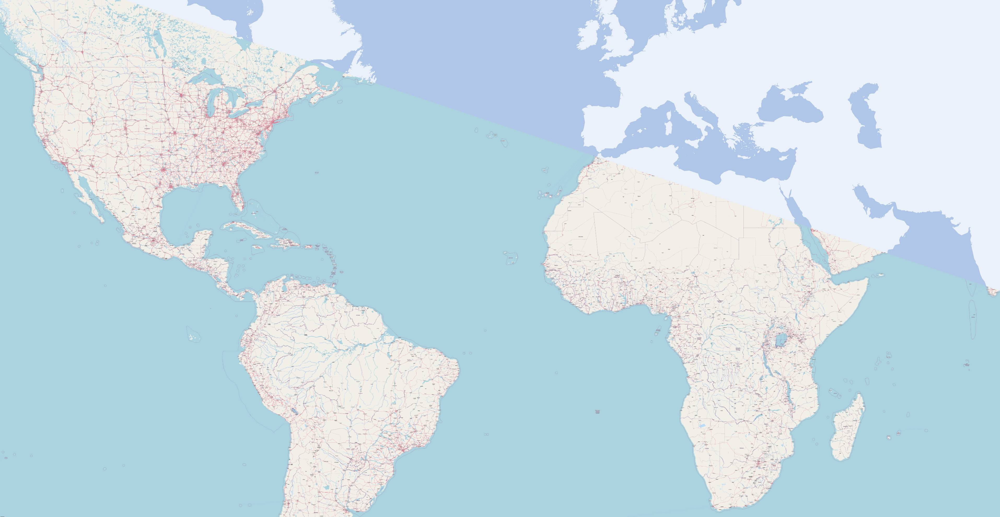

# mod_tile and renderd



**`mod_tile`** and **`renderd`** form the classic raster map tile stack powering [OpenStreetMap.org](https://www.openstreetmap.org/):

- **`mod_tile`**: A high-performance Apache 2 HTTP module that serves map tiles, manages HTTP cache headers and rate limiting, exposes Prometheus metrics, and communicates with a rendering daemon to generate missing or outdated tiles on demand.
- **`renderd`**: A multithreaded rendering daemon that uses [Mapnik](https://mapnik.org/) to render map tiles via a prioritized queuing system.

> **Alternative Backend:** [Tirex](https://github.com/openstreetmap/tirex) can be used as a drop-in replacement for `renderd` alongside `mod_tile`.

## Table of Contents

- [Features & Architecture](#features--architecture)
  - [Tile Serving (`mod_tile`)](#tile-serving-mod_tile)
  - [Tile Rendering (`renderd`)](#tile-rendering-renderd)
  - [Tile Storage (`store_file.c`)](#tile-storage-store_filec)
- [Dependencies](#dependencies)
- [Installation](#installation)
- [Building from Source](#building-from-source)
- [Quickstart & Configuration](#quickstart--configuration)
- [Command-Line Utilities](#command-line-utilities)
- [Documentation & Manpages](#documentation--manpages)
- [Performance](#performance)
- [License](#license)

---

## Features & Architecture

### Tile Serving (`mod_tile`)

`mod_tile` extends Apache HTTPD's file-serving pipeline with map-specific capabilities:

- **On-Demand Rendering & Expiry:** Detects missing (`tileMissing`) or stale (`tileOld`, `tileVeryOld`) tiles by comparing tile modification times against planet database import timestamps (`/planet-import-complete`), and requests rendering or re-rendering from `renderd`. Supports `/status` and `/dirty` URL suffixes (`ModTileEnableStatusURL`, `ModTileEnableDirtyURL`) for inspecting freshness or manually triggering background re-renders.
- **Smart HTTP Caching:** Computes HTTP `Cache-Control` (`max-age`) and `Expires` headers using configurable zoom-level minimums (`ModTileCacheDurationLowZoom`, `ModTileCacheDurationMediumZoom`, `ModTileCacheDurationMinimum`), tile modification age (`ModTileCacheLastModifiedFactor`), dirty-tile lifetimes (`ModTileCacheDurationDirty`), extended-cache hostname rules (`ModTileCacheExtendedHostName`), randomized jitter to prevent cache stampedes, and `ModTileCacheDurationMax`. Emits MD5 `ETag` headers with HTTP `304 Not Modified` conditional response handling.
- **Dynamic URL Parameterization:** Supports runtime style adjustments via URL path segments before `/{z}/{x}/{y}.{ext}` (configured via `parameterize_style` in `renderd.conf` and cached per option string in `renderd`):
  - **`language`**: Dynamically localizes map labels (e.g., `/tiles/layer/en,de,_/0/0/0.png`).
  - **`toggle_layer`**: Dynamically enables or disables Mapnik layers (e.g., `/tiles/layer/-layer1,-layer2,+layer2/0/0/0.png`).
- **TileJSON & CORS Support:** Automatically serves TileJSON 2.0.0 layer metadata at `{URI}/tile-layer.json` (including attribution, description, zoom bounds, and server aliases) and supports per-layer Cross-Origin Resource Sharing (`cors`) headers.
- **Pluggable Storage Backends:** Supports local POSIX filesystems (`/...`), Ceph RADOS object stores (`rados://...`), Memcached (`memcached://...`), read-only HTTP/HTTPS upstream tile proxies (`ro_http_proxy://...`), Cairo-backed read-only composite layers (`composite:{...}`), and a no-op null backend (`null://...`) for benchmarking.
- **Traffic Control & Load Shedding:** Built-in per-IP token-bucket rate limiting (`ModTileEnableTileThrottling`, `ModTileThrottlingTiles`, `ModTileThrottlingRenders`) with `X-Forwarded-For` proxy support (`ModTileEnableTileThrottlingXForward`), plus 1-minute system load shedding (`ModTileMaxLoadOld` default `16`, `ModTileMaxLoadMissing` default `50`).
- **Metrics & Monitoring:** Exposes native **Prometheus** metrics at `/metrics` and plain-text server statistics at `/mod_tile` (HTTP status counts, cache hit/miss/render outcomes, per-zoom request/latency counters, and per-layer totals) controlled by `ModTileEnableStats`.

### Tile Rendering (`renderd`)

- **Prioritized Multithreaded Queuing:** Listens on a UNIX domain socket (`/run/renderd/renderd.sock`) or TCP port (default `7654`) using a versioned binary IPC protocol (`PROTO_VER = 3`, backwards-compatible with v1/v2). Coalesces duplicate concurrent requests for the same metatile and processes jobs across five queues in strict priority order:
  1. **`reqPrio` (`cmdRenderPrio`)**: High-priority on-the-fly rendering for missing tiles (capped at `REQ_LIMIT = 256`).
  2. **`req` (`cmdRender`)**: Standard-priority on-the-fly rendering, including heavily expired tiles exceeding `ModTileVeryOldThreshold` (default 365 days; capped at `REQ_LIMIT = 256`).
  3. **`reqLow` (`cmdRenderLow`)**: Low-priority on-the-fly re-rendering for expired (`tileOld`) tiles (capped at `REQ_LIMIT = 256`).
  4. **`dirty` (`cmdDirty`)**: Background queue for asynchronous expiry requests and overflow from saturated interactive/bulk queues (capped at `DIRTY_LIMIT = 8000`).
  5. **`reqBulk` (`cmdRenderBulk`)**: Lowest-priority queue for batch pre-rendering (`render_list`, `render_expired`, or `ModTileBulkMode On`; capped at `REQ_LIMIT = 256`).
- **Flexible Mapnik Rendering:** Supports custom tile dimensions (`tilesize`, default `256` px), HiDPI/Retina scale factors (`scale` from `0.1` to `8.0`), multiple image writers (`png256`, `png32`, `jpeg`, `webp`), automatic datasource connection pool scaling (`max_size = num_threads + 2` when `num_threads > 10`), and built-in projection handling for Web Mercator, Plate Carrée (`+proj=eqc`), and British National Grid (`OSGB36`).
- **HTCP Cache Invalidation:** Sends RFC 2756 HTCP `CLR` UDP purge datagrams (default UDP port `4827`) to upstream caching proxies configured via `htcphost` whenever metatiles are rendered and saved.
- **Distributed Rendering & Runtime Stats:** Scales horizontally across multiple machines using a master/slave architecture (`renderd --slave` and `[renderd0]`–`[renderd4]` sections in `renderd.conf`, up to `MAX_SLAVES = 5`) and optionally dumps periodic queue/render statistics to `stats_file`.

### Tile Storage (`store_file.c`)

When using the default POSIX filesystem storage backend (`store_file.c`), `renderd` groups an **8×8 grid (64 tiles)** into a single **metatile** `.meta` archive stored in a bitwise-interleaved directory hierarchy (`DIRECTORY_HASH`) to avoid inode exhaustion and directory bottlenecks from millions of tiny image files:

```text
/[base_dir]/[TileSetName]/[Z]/[xxxxyyyy]/[xxxxyyyy]/[xxxxyyyy]/[xxxxyyyy]/[xxxxyyyy].meta
```

- `base_dir`: Configurable tile cache root (default: `/var/cache/renderd/tiles`).
- `TileSetName`: Map section name defined in `/etc/renderd.conf`.
- `Z`: Zoom level (`0`–`20` by default via `MAX_ZOOM`, up to `30` via `MAX_ZOOM_SERVER` / `AddTileConfig`).
- `[xxxxyyyy]`: 8-bit directory hashes interleaving 4 bits of the X coordinate and 4 bits of the Y coordinate, clustering 16×16 metatiles per subdirectory.

Apache transparently maps incoming standard tile requests (`/[TileSetName]/{Z}/{X}/{Y}.{ext}`) to the corresponding metatile offset.

---

## Dependencies

### Supported Platforms & Build Systems

- **Operating Systems:** GNU/Linux, FreeBSD, OpenBSD, macOS
- **Build Systems:** [CMake](https://cmake.org/) _(recommended)_, [GNU Autotools](https://www.gnu.org/software/software.html) _(deprecated)_

### Runtime & Build Libraries

| Dependency                                                   | Required | Description                                                            |
| ------------------------------------------------------------ | -------- | ---------------------------------------------------------------------- |
| [Apache HTTP Server](https://httpd.apache.org/)              | Yes      | Web server (`httpd` / `apache2` dev headers, APR, APXS)                |
| [Mapnik](https://mapnik.org/)                                | Yes      | Map rendering engine (`libmapnik`, Mapnik 3 or 4)                      |
| [ICU](https://icu.unicode.org/)                              | Yes      | International Components for Unicode (`libicu`, linked into `renderd`) |
| [GLib](https://gitlab.gnome.org/GNOME/glib)                  | Yes      | Core utility library (`libglib-2.0`)                                   |
| [iniParser](https://github.com/ndevilla/iniparser)           | Yes      | Configuration file parser for `renderd.conf` (`libiniparser`)          |
| [Cairo](https://cairographics.org/)                          | Optional | Read-only composite tile storage backend (`libcairo`)                  |
| [cURL](https://curl.se/)                                     | Optional | HTTP/HTTPS proxy tile storage backend (`libcurl`)                      |
| [Memcached](https://libmemcached.org/)                       | Optional | Memcached tile storage backend (`libmemcached`)                        |
| [RADOS](https://docs.ceph.com/en/latest/rados/api/librados/) | Optional | Ceph RADOS object tile storage backend (`librados`)                    |
| Custom `malloc` (`MALLOC_LIB`)                               | Optional | Alternate allocator (e.g., `jemalloc`/`tcmalloc`; defaults to `libc`)  |

---

## Installation

Pre-built packages are available on **Debian 11 (Bullseye)+** and **Ubuntu 21.04 (Hirsute Hippo)+** (maintained by the [Debian GIS Team](https://wiki.debian.org/DebianGis) in their [packaging repository](https://salsa.debian.org/debian-gis-team/libapache2-mod-tile)):

```bash
sudo apt update
sudo apt install libapache2-mod-tile renderd
```

---

## Building from Source

If you are developing `mod_tile` or running on a distribution without pre-built packages, follow the step-by-step build guides for your OS:

- [Arch Linux](/docs/build/building_on_arch_linux.md)
- [CentOS Stream](/docs/build/building_on_centos_stream.md)
- [Debian](/docs/build/building_on_debian.md)
- [Fedora](/docs/build/building_on_fedora.md)
- [FreeBSD](/docs/build/building_on_freebsd.md)
- [macOS](/docs/build/building_on_macos.md)
- [OpenBSD](/docs/build/building_on_openbsd.md)
- [openSUSE](/docs/build/building_on_opensuse.md)
- [Ubuntu](/docs/build/building_on_ubuntu.md)

> **Docker & CI:** A Docker-based build and test environment is available in [`/docker`](/docker). For exact build flags and dependency setups, see our [GitHub Actions CI workflow](/.github/workflows/build-and-test.yml).

---

## Quickstart & Configuration

Sample configuration files are located in [`etc/`](/etc), and a self-contained test map is included in [`utils/example-map/`](/utils/example-map). _(Note: Paths below assume Debian/Ubuntu conventions and may vary by distribution.)_

1. **Copy the example map data:**

```bash
sudo mkdir -p /usr/share/renderd
sudo cp -av utils/example-map /usr/share/renderd/
```

2. **Install the example Apache virtual host configuration:**

```bash
sudo cp -av etc/apache2/renderd-example-map.conf /etc/apache2/sites-available/renderd-example-map.conf
```

3. **Register the example map layers in `/etc/renderd.conf`** (supports up to `XMLCONFIGS_MAX = 100` map sections; trailing slashes are appended automatically to `URI` values, and any parent URI prefix must be listed _after_ more specific child URI paths):

```bash
cat << 'EOF' | sudo tee -a /etc/renderd.conf
[example-map]
URI=/tiles/renderd-example
XML=/usr/share/renderd/example-map/mapnik.xml

[example-map-jpg]
TYPE=jpg image/jpeg jpeg
URI=/tiles/renderd-example-jpg
XML=/usr/share/renderd/example-map/mapnik.xml

[example-map-png256]
TYPE=png image/png png256
URI=/tiles/renderd-example-png256
XML=/usr/share/renderd/example-map/mapnik.xml

[example-map-png32]
TYPE=png image/png png32
URI=/tiles/renderd-example-png32
XML=/usr/share/renderd/example-map/mapnik.xml

[example-map-webp]
TYPE=webp image/webp webp
URI=/tiles/renderd-example-webp
XML=/usr/share/renderd/example-map/mapnik.xml
EOF
```

4. **Ensure the runtime socket directory exists and start `renderd`:**

```bash
sudo mkdir -p /run/renderd
sudo renderd
```

5. **Enable the Apache module, site configuration, and restart Apache:**

```bash
sudo a2enmod tile
sudo a2ensite renderd-example-map
sudo apache2ctl restart
```

6. **Verify the setup** by opening the interactive example map or requesting a single tile:

- Slippy map viewer: `http://localhost:8081/renderd-example-map`
- Single tile (`z=0, x=0, y=0`): `http://localhost:8081/tiles/renderd-example/0/0/0.png`

> **Full Planet / Production Setup:** For complete instructions on setting up a production OpenStreetMap tile server with PostgreSQL, PostGIS, and `osm2pgsql`, see the [switch2osm serving tiles guide](https://switch2osm.org/serving-tiles/).

---

## Command-Line Utilities

In addition to `renderd` and `mod_tile.so`, this repository builds several CLI tools for cache management and benchmarking:

| Command                | Purpose                                                                                                                                                                                                                            |
| ---------------------- | ---------------------------------------------------------------------------------------------------------------------------------------------------------------------------------------------------------------------------------- |
| **`renderd`**          | The core tile rendering daemon (`-f` for foreground debugging, `-c` for custom config, `-s` for slave index).                                                                                                                      |
| **`render_list`**      | Pre-renders tiles from an `X Y Z` list on `STDIN` or across a zoom, tile-coordinate (`--min-x`/`--max-x`/`--min-y`/`--max-y`), or WGS84 lat/lon bounding-box range (`--all`), skipping cached metatiles unless `--force` is given. |
| **`render_expired`**   | Reads a `z/x/y` list of modified tiles on `STDIN` (e.g., from `osm2pgsql`), expands ancestor metatiles across zoom levels, and deletes (`--delete-from`), marks expired (`--touch-from`), or re-renders them.                      |
| **`render_speedtest`** | Benchmarks rendering throughput across zoom levels against a running `renderd` instance.                                                                                                                                           |
| **`render_old`**       | Pre-renders expired/outdated tiles by submitting requests to `renderd`.                                                                                                                                                            |

---

## Documentation & Manpages

Detailed reference documentation for all directives, INI options, and CLI flags is provided in the repository's manpages (in [`docs/man/`](/docs/man)):

- **`mod_tile(5)`** — Apache HTTPD configuration directives (`AddTileConfig`, `LoadTileConfigFile`, caching durations, socket timeouts, throttling).
- **`renderd(1)`** — Rendering daemon CLI flags and master/slave operation.
- **`renderd.conf(5)`** — INI sections (`[renderd]`, `[mapnik]`, and map layer options including `parameterize_style`, `scale`, `tilesize`, `htcphost`, and `type`).
- **`render_list(1)`**, **`render_expired(1)`**, **`render_speedtest(1)`**, **`render_old(1)`** — CLI utility usage and options.

---

## Performance

- **Serving (`mod_tile`):** Engineered for high-concurrency static/cached delivery. Given adequate disk I/O or page-cache memory, a single server can sustain **>10,000 tiles/second**.
- **Rendering (`renderd`):** Rendering throughput depends primarily on PostGIS database query performance and Mapnik stylesheet complexity. `renderd` scales linearly across multi-core CPUs (`num_threads=-1` auto-detects online CPU core count via `sysconf(_SC_NPROCESSORS_ONLN)`) and supports multi-server master/slave clusters for heavy rendering workloads.

---

## License

Copyright © 2007–2026 by `mod_tile` contributors (see [AUTHORS](/AUTHORS)).

This program is free software: you can redistribute it and/or modify it under the terms of the **GNU General Public License** as published by the Free Software Foundation, either version 2 of the License, or (at your option) any later version.

See [COPYING](/COPYING) for the full license text.
